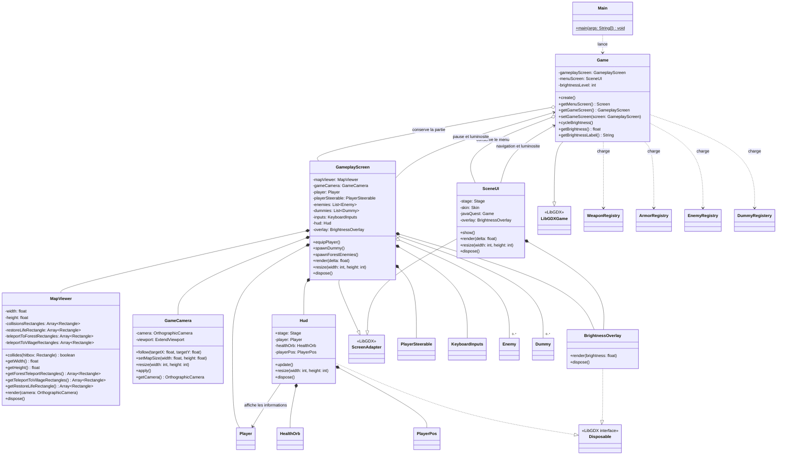
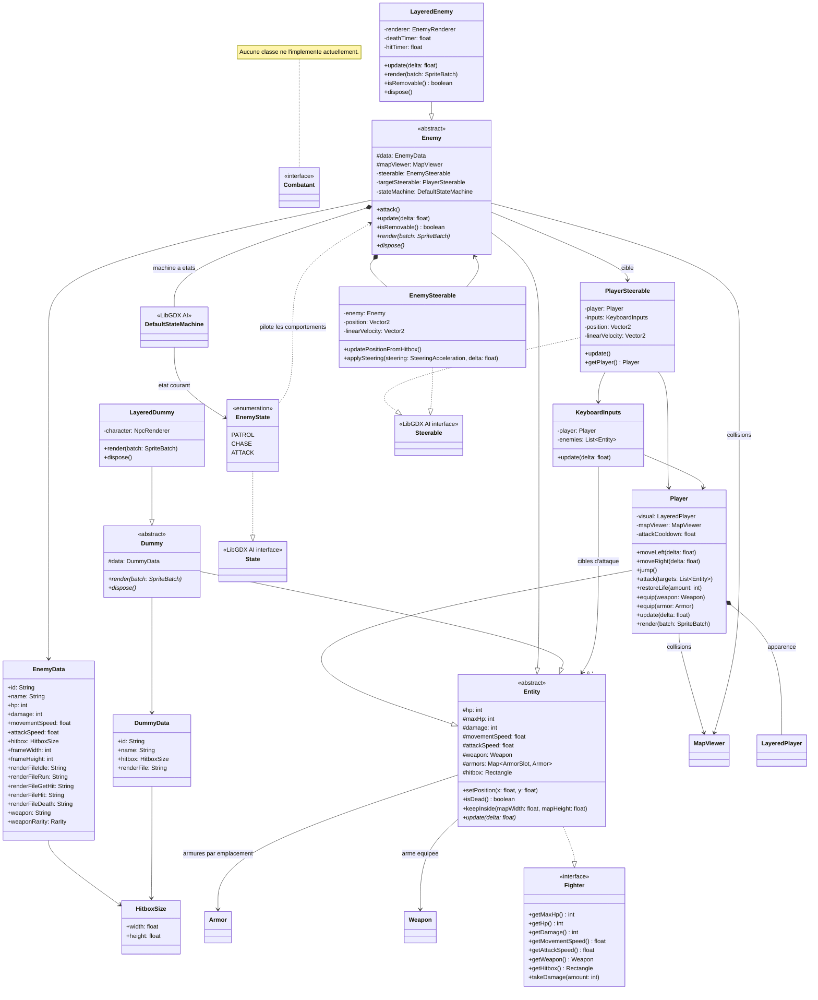
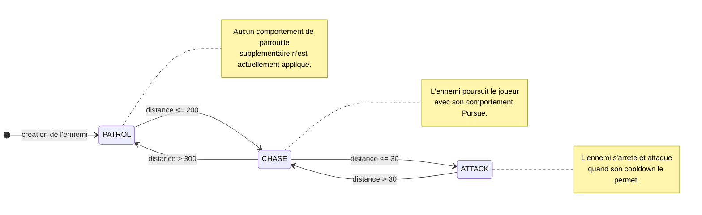
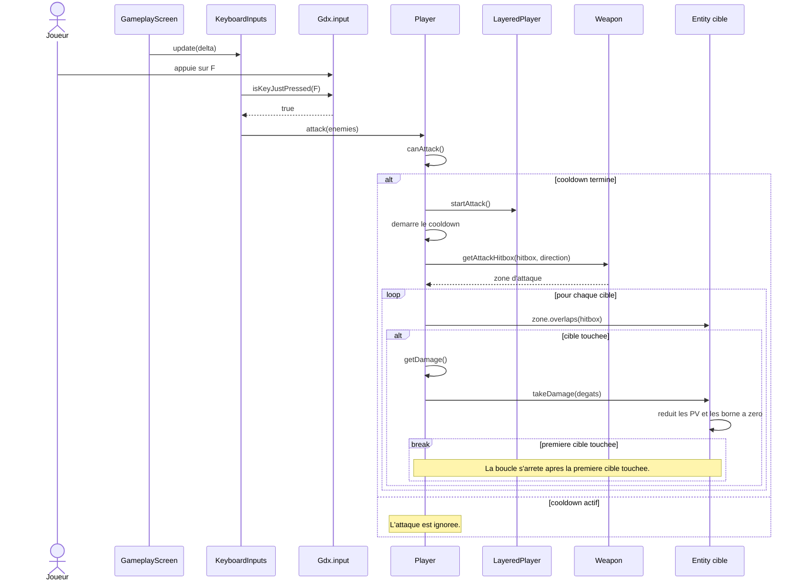
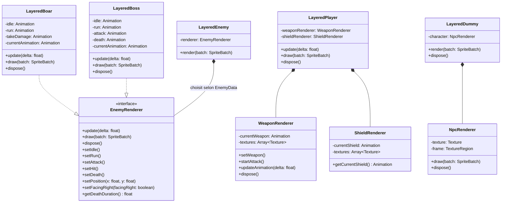
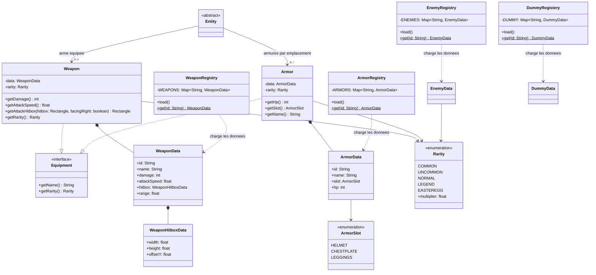
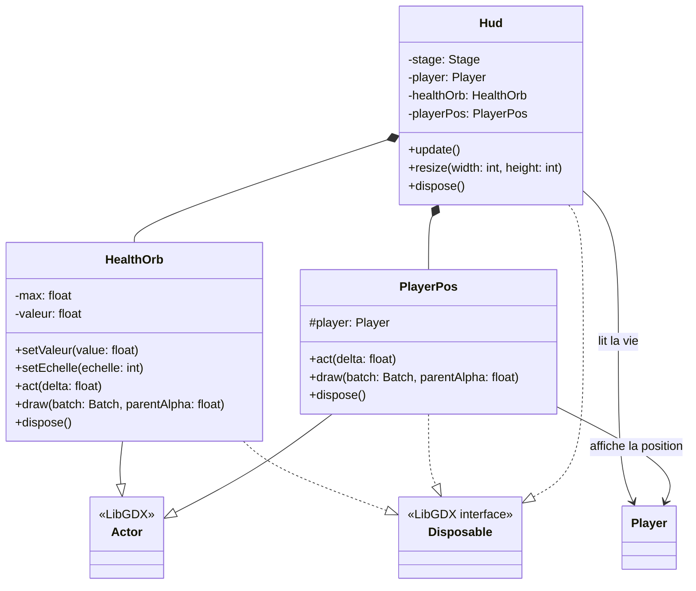

# Diagrammes UML de TheJavaQuest

Les diagrammes sont repartis par responsabilite pour rester lisibles. Les classes LibGDX
utilisees comme dependances sont simplifiees et marquees `<<LibGDX>>`.

## Application et ecrans

## Entites et intelligence artificielle

## Machine a etats de l'ennemi

La machine a etats est initialisee en `PATROL`. Les distances sont mesurees entre le
centre de l'ennemi et celui du joueur. Les transitions suivent les seuils implementes
dans `EnemyState`.

La mort est geree par `LayeredEnemy` pour jouer l'animation puis retirer l'ennemi ;
elle ne constitue pas un etat de `EnemyState`.

## Sequence d'une attaque du joueur

Ce diagramme montre le traitement de la touche `F`, de la verification du cooldown
jusqu'a l'application des degats a la premiere cible touchee.

## Rendu des personnages

## Equipements et donnees

## HUD

### Legende

- `--|>` : heritage ; `..|>` : implementation d'une interface.
- `*--` : composition ; `o--` : agregation ; `-->` / `..>` : association ou dependance.
- Les membres sont limites aux attributs et operations utiles a la comprehension des relations.
